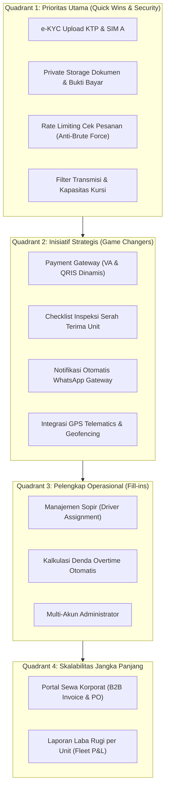
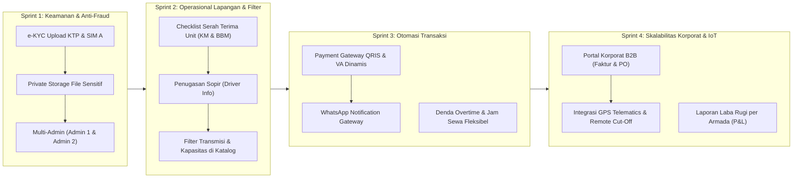

# Dokumen Analisis Kebutuhan Pengguna, Evaluasi Celah Sistem, dan Roadmap Pengembangan Web Rental Mobil Padaidi

Dokumen ini menyajikan analisis komprehensif terhadap sistem web Rental Mobil Padaidi (berbasis Laravel, MySQL, dan arsitektur clean server-side pricing). Analisis ini mengevaluasi kebutuhan nyata dari setiap pemangku kepentingan (stakeholders), membedah kelemahan dan celah operasional/keamanan yang rentan dieksploitasi dalam industri rental mobil di Indonesia, serta merumuskan peta jalan (roadmap) penambahan fitur bernilai tinggi.

---

## 1. Analisis Kebutuhan Pengguna (User Requirements Analysis)

Industri rental kendaraan memiliki ekosistem operasional yang melibatkan pelanggan perorangan, korporasi, petugas pool, sopir, hingga manajemen keuangan.

### 1.1. Profil Persona & Analisis Kebutuhan

#### A. Pelanggan Perorangan (Wisatawan & Pemudik)
* **Karakteristik**: Menyewa untuk liburan keluarga, perjalanan dinas luar kota, atau mudik hari raya.
* **Kebutuhan Utama**:
  * **Kemudahan Pemesanan Cepat Tanpa Akun Ribet**: Kemampuan memilih tanggal, transmisi (Matic/Manual), dan kategori mobil (City Car, MPV, SUV) dalam waktu singkat.
  * **Transparansi Kondisi & Biaya**: Mengetahui spesifikasi asli mobil (tahun, kapasitas penumpang, jenis bahan bakar) tanpa ada biaya tersembunyi (*hidden fee*).
  * **Kejelasan Opsi Tambahan (Add-on)**: Fleksibilitas memilih paket lepas kunci (*self-drive*) atau dengan sopir (*with driver*), asuransi perlindungan benturan, dan opsi antar-jemput ke Bandara/Stasiun atau alamat rumah.
  * **Metode Pembayaran Instan & Aman**: Kemudahan bayar via QRIS atau Virtual Account bank tanpa harus menunggu admin mengecek rekening secara manual.

#### B. Pelanggan Korporat & Instansi Pemerintahan (B2B)
* **Karakteristik**: Perusahaan atau instansi yang membutuhkan sewa jangka menengah (mingguan/bulanan) untuk tamu VIP atau operasional dinas.
* **Kebutuhan Utama**:
  * **Pemesanan Multi-Unit**: Memesan lebih dari 1 kendaraan dalam satu berkas pemesanan.
  * **Faktur & Dokumen Formal**: Butuh Purchase Order (PO), Invoice penagihan resmi dengan termin pembayaran (*Terms of Payment* 14–30 hari), serta Faktur Pajak PPh/PPN.
  * **Standardisasi Kendaraan**: Kepastian armada berumur muda (< 4 tahun), interior bersih, dan pengemudi berstandar profesional (rapi dan menguasai rute).

#### C. Admin Customer Service & Reservasi
* **Karakteristik**: Staf pengelola pesanan masuk di kantor pusat.
* **Kebutuhan Utama**:
  * **Dasbor Kalender Ketersediaan Armada (*Fleet Timeline View*)**: Memantau jadwal pergerakan mobil mana yang keluar hari ini, mana yang harus kembali, dan mana yang sedang dalam jadwal servis.
  * **Verifikasi Pembayaran Otomatis**: Menghindari beban manual mencocokkan mutasi rekening bank dan mencegah penipuan struk palsu.
  * **Penyaringan Risiko (*Risk Profiling*)**: Memeriksa kelayakan calon penyewa lepas kunci berdasarkan dokumen identitas (e-KYC KTP & SIM A) sebelum pesanan disetujui/diserahkan.

#### D. Petugas Lapangan / Dispatcher Pool
* **Karakteristik**: Staf yang menyerahkan kunci mobil kepada pelanggan di bandara/kantor/pool.
* **Kebutuhan Utama**:
  * **Formulir Serah Terima Digital (*Digital Handover Checklist*)**: Mencatat kondisi bodi mobil (posisi goresan/baret), tingkat bahan bakar, dan angka odometer (kilometer awal) langsung dari ponsel.
  * **Tanda Tangan Digital Pelanggan**: Bukti persetujuan kondisi fisik mobil sebelum mobil dibawa pergi untuk mencegah sengketa saat mobil kembali.
  * **Pemeriksaan Pengembalian Cepat**: Membandingkan kondisi awal vs kondisi akhir saat mobil dikembalikan.

#### E. Pengemudi (Driver)
* **Karakteristik**: Sopir yang ditugaskan melayani pelanggan paket *with driver*.
* **Kebutuhan Utama**:
  * **Jadwal Kerja Jelas**: Informasi titik jemput, waktu penjemputan, kontak WhatsApp pelanggan, dan durasi sewa agar jadwal tidak bentrok dengan penyewa lain.
  * **Transparansi Biaya Operasional**: Kepastian klaim uang makan, BBM, tiket tol, dan akomodasi bila menginap di luar kota.

#### F. Pemilik Rental (Owner / Fleet Manager)
* **Karakteristik**: Pengambil keputusan bisnis dan pemilik modal.
* **Kebutuhan Utama**:
  * **Keamanan Aset (*Anti-Pencurian / Anti-Penggelapan*)**: Visibilitas posisi kendaraan melalui GPS pelacak dan peringatan otomatis jika kendaraan keluar dari wilayah operasional yang disepakati (*geofencing*).
  * **Laporan Laba Rugi per Unit Mobil (*Fleet Profitability*)**: Mengetahui pendapatan sewa per pelat nomor dikurangi biaya servis rutin, penggantian ban/oli, asuransi, dan cicilan leasing mobil.
  * **Tingkat Utilisasi Armada (*Occupancy Rate*)**: Persentase hari mobil tersewa vs hari mobil menganggur di garasi.

---

## 2. Analisis Kekurangan Sistem Saat Ini (System Limitation & Gap Analysis)

| Area / Modul | Kondisi Sistem Awal | Keterbatasan & Dampak Operasional | Solusi & Status Implementasi |
|---|---|---|---|
| **Metode Pembayaran & Privasi Berkas** | Transfer manual & upload bukti ke folder public `storage/app/public/payments`. | Rentan manipulasi struk transfer m-Banking palsu. Link bukti transfer terbuka untuk publik. | **Diperbaiki**: Berkas bukti dipindahkan ke penyimpanan lokal privat (`storage/app/private/payments`) dengan akses terproteksi otorisasi sesi/admin. |
| **Verifikasi e-KYC (Identitas)** | Tabel `customer_documents` ada tetapi belum digunakan di tampilan layar. | Risiko penggelapan mobil lepas kunci; admin harus meminta foto KTP manual via WA. | **Diimplementasikan**: Form upload e-KYC (KTP & SIM A) mandiri untuk penyewa, verifikasi valid/tolak di panel admin. |
| **Manajemen Sopir** | Sopir hanya berupa addon harga, tanpa informasi penugasan. | Tidak ada pencatatan nama dan kontak sopir yang bertugas di pesanan pelanggan. | **Diimplementasikan**: Admin dapat menginput nama & nomor HP sopir bertugas; tombol kontak WA sopir tampil di halaman pelanggan. |
| **Serah Terima Unit (Inspeksi)** | Transisi status tombol satu klik tanpa pencatatan kondisi fisik unit. | Risiko sengketa baret baru dan perdebatan selisih BBM saat unit kembali. | **Diimplementasikan**: Checklist serah terima digital mencatat KM awal, BBM awal, dan catatan baret fisik saat serah terima & pengembalian. |
| **Denda & Overtime** | Tanggal kembali kaku per hari tanpa penanganan jam overtime. | Perhitungan denda keterlambatan dan selisih bensin harus dihitung manual di luar sistem. | **Diimplementasikan**: Kolom overtime hours, denda overtime, dan biaya ekstra selisih bensin/baret dihitung ke Total Tagihan. |
| **Filter Pencarian Armada** | Hanya menyaring berdasarkan kategori dan tanggal sewa. | Pelanggan kesulitan menyaring mobil bertransmisi Matic vs Manual atau kapasitas kursi. | **Diimplementasikan**: Filter transmisi (`manual`, `automatic`) dan kapasitas kursi (`>= 5`, `>= 7`) aktif di katalog `/armada`. |

---

## 3. Analisis Celah Keamanan, Penipuan (Fraud), dan Celah Bisnis

### 3.1. Celah Penipuan & Penggelapan Unit (Fraud Risk - Ancaman Tertinggi)
1. **Risiko Penggelapan Kendaraan (*Car Embezzlement*) pada Sewa Lepas Kunci**
   * **Celah**: Pemesanan tanpa akun mempermudah pelaku kejahatan menyewa dengan nama fiktif jika dokumen KTP/SIM tidak divalidasi.
   * **Mitigasi**:
     * Pengaktifan modul e-KYC: Pelanggan wajib mengunggah KTP dan SIM A asli sebelum mobil diserahkan.
     * Pencatatan nomor identitas resmi dan verifikasi oleh admin sebelum status diubah ke *Active*.
     * Integrasi telematika GPS dan geofencing alert untuk armada di fase berikutnya.
2. **Celah Struk Pembayaran Palsu (*Fake Payment Slip Exploitation*)**
   * **Celah**: Admin rentan terkecoh gambar struk m-banking hasil generator palsu jika tidak memeriksa mutasi rekening.
   * **Mitigasi**:
     * Panel admin mewajibkan verifikasi manual sebelum status pembayaran diubah menjadi *Terverifikasi*.
     * Rencana integrasi Payment Gateway otomatis (QRIS dinamis & Virtual Account).

### 3.2. Celah Keamanan Teknis & Privasi Data
1. **Kerentanan Akses Informasi Pesanan (Insecure Order Lookup / IDOR)**
   * **Celah**: Pencarian kode pesanan rentan serangan *brute force* bila tidak dibatasi.
   * **Mitigasi**: Menerapkan rate limiting ketat pada endpoint `/cek-pesanan` (maksimal 5 percobaan per menit per IP) dan validasi kecocokan nomor HP.
2. **Penyimpanan Berkas Sensitif di Direktori Terbuka**
   * **Celah**: Berkas bukti bayar dan KTP yang disimpan di `storage/app/public` dapat diakses langsung via URL browser.
   * **Mitigasi**: Menggunakan disk lokal privat (`storage/app/private/`) dengan serving controller terautentikasi (hanya admin atau pemilik pesanan yang sah yang bisa mengakses).

---

## 4. Evaluasi Fitur yang Ada (Existing Feature Evaluation)

| Modul Fitur | Status Kematangan | Keunggulan Sistem | Peningkatan yang Diterapkan |
|---|---|---|---|
| **Mesin Pencarian & Filter** | Sangat Baik | Logika irisan tanggal `[pickup, return)` presisi, menyaring mobil tersedia tanpa tumpang tindih. | Ditambahkan filter transmisi (Matic/Manual) dan kapasitas kursi (5/7 penumpang). |
| **Pencegahan Overbooking** | Unggul | Transaksi database dengan penguncian baris (`Car::lockForUpdate()`), menjamin *zero overbooking*. | Dipertahankan sebagai standar utama transaksi. |
| **Kalkulasi Harga Server-Side** | Unggul | Mengabaikan manipulasi harga browser (`PricingService`); harga dihitung ulang secara independen di server. | Mendukung penambahan denda overtime dan biaya ekstra pada total tagihan akhir. |
| **Alur Status Transisi** | Unggul | Finite State Machine (`BookingStatus`) mencegah loncatan status tidak sah. | Dilengkapi formulir inspeksi serah terima saat penyerahan unit dan pengembalian unit. |
| **Penyimpanan Berkas** | Diperketat | Pemisahan penyimpanan aset publik (foto mobil) dengan dokumen sensitif pelanggan. | Bukti bayar dan identitas e-KYC disimpan di private storage. |

---

## 5. Matriks Prioritas Roadmap Fitur

Berikut adalah visualisasi prioritas pengembangan sistem Rental Mobil Padaidi:

---

## 6. Peta Jalan Implementasi (Implementation Roadmap)

---

## 7. Rekapitulasi Akun Administrator Sistem

Sistem kini dilengkapi dengan 2 akun administrator aktif:
1. **Admin 1 (Utama / Pusat)**:
   * **Nama**: Admin Padaidi
   * **Email**: `admin@padaidi.test`
   * **WhatsApp**: `6282197233174`
   * **Password**: `padaidi-admin-123`
2. **Admin 2 (Operasional & Reservasi)**:
   * **Nama**: Admin Padaidi 2 (Operasional)
   * **Email**: `admin2@padaidi.test`
   * **WhatsApp**: `6282235585445`
   * **Password**: `padaidi-admin-123`
