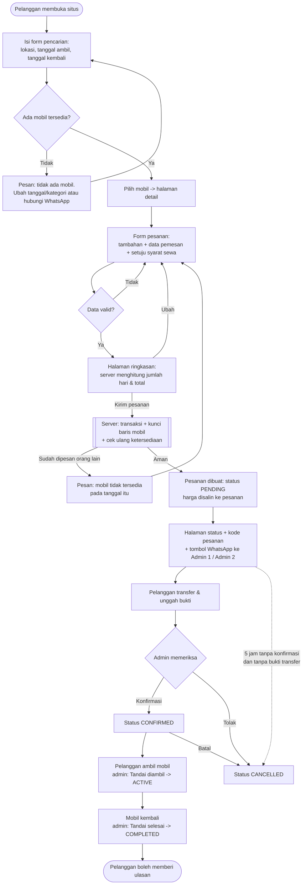
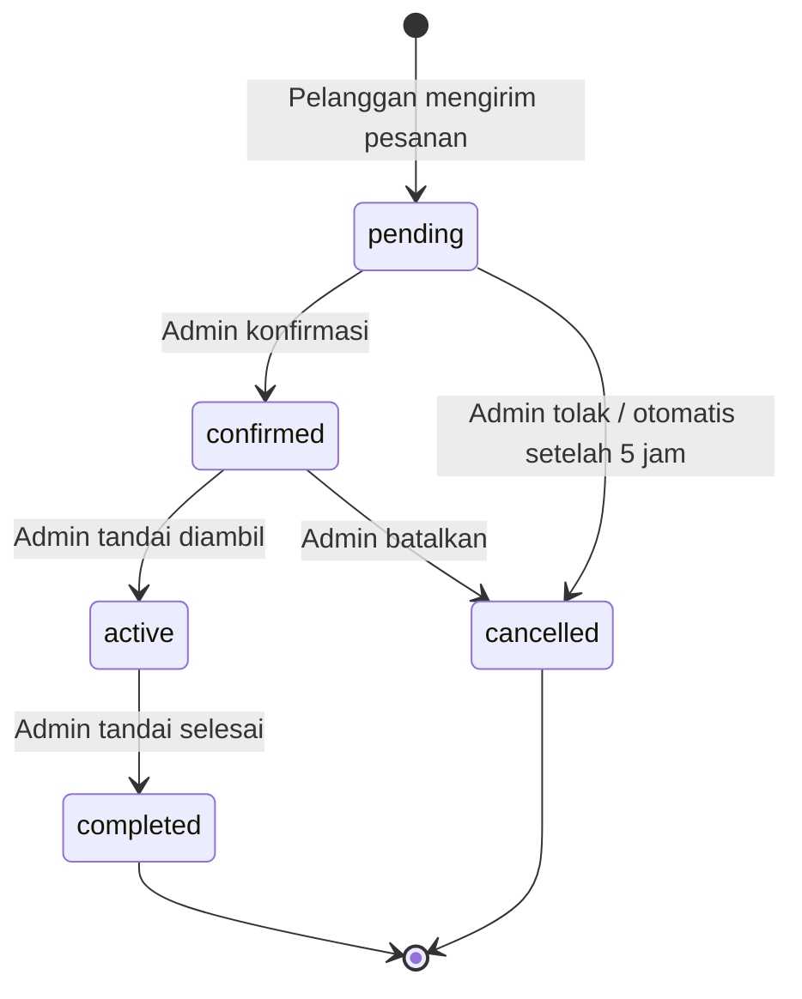

# Alur Sistem Padaidi Rental Mobil

Dokumen ini menjelaskan cara kerja aplikasi untuk pemilik usaha dan admin, dalam bahasa sehari-hari.
Setiap langkah di bawah sudah dicocokkan dengan kode (nama file disebut dalam kurung untuk tim teknis).

## 1. Peran

### Pelanggan (tidak perlu membuat akun)
- Mencari mobil berdasarkan lokasi ambil, tanggal ambil, dan tanggal kembali.
- Melihat daftar armada (bisa disaring per kategori) dan detail mobil.
- Memesan: memilih tambahan (sopir, asuransi, antar-jemput), mengisi data diri, melihat ringkasan & total, lalu mengirim pesanan.
- Mendapat **kode pesanan** (contoh `PDD-AB12CD`) dan tombol WhatsApp untuk memberi tahu admin.
- Membuka halaman status pesanan (dengan kode + nomor HP), mengunggah bukti transfer, dan memberi ulasan setelah sewa selesai.

### Admin (harus login di `/admin/login`)
- Melihat dasbor: jumlah pesanan per status, jadwal ambil hari ini, mobil yang harus kembali.
- Mengelola pesanan: **Konfirmasi**, **Tolak/Batalkan**, **Tandai diambil**, **Tandai selesai**, catatan internal.
- Mencatat pembayaran (tunai/transfer) dan memverifikasi/menolak bukti transfer pelanggan.
- Mengelola armada (tambah/ubah/hapus + foto), tambahan, lokasi, dan jadwal servis mobil.

## 2. Diagram alur pemesanan

## 3. Diagram status pesanan

| Status (kode) | Nama di layar | Arti |
|---|---|---|
| `pending` | Menunggu konfirmasi | Pesanan baru, tanggal sudah "dipegang" untuk pelanggan ini |
| `confirmed` | Dikonfirmasi | Admin menyetujui pesanan |
| `active` | Sedang disewa | Mobil sudah diambil pelanggan |
| `completed` | Selesai | Mobil sudah kembali |
| `cancelled` | Dibatalkan | Ditolak/dibatalkan admin atau otomatis |

Status **tidak boleh melompat**. Contoh: pesanan `pending` tidak bisa langsung `completed`; pesanan `active` tidak bisa dibatalkan.
Tombol yang tidak berlaku tidak ditampilkan, dan server tetap menolak bila dipaksa (`app/Enums/BookingStatus.php`, `BookingService::transition`).

## 4. Aturan bisnis

1. **Jumlah hari** = tanggal kembali − tanggal ambil, minimal 1 hari. Tanggal kembali harus setelah tanggal ambil.
   Contoh: ambil 10 Agustus, kembali 12 Agustus = **2 hari**.
2. **Rentang sewa dihitung [ambil, kembali)** – hari kembali tidak dihitung sebagai hari sewa. Jadi mobil yang
   kembali tanggal 12 **boleh diambil pelanggan lain tanggal 12**.
3. **Total** = harga per hari × jumlah hari + total tambahan − diskon.
   - Tambahan "per hari" (Sopir, Asuransi) dikali jumlah hari; tambahan "sekali bayar" (Antar-jemput) dihitung sekali.
   - Bila pelanggan memilih lokasi **Antar ke alamat**, alamat wajib diisi dan biaya **Antar-jemput** otomatis ditambahkan.
   - Diskon saat ini selalu 0 (fitur promo di luar cakupan), tetapi rumusnya sudah siap.
4. **Harga dihitung ulang di server.** Angka total yang dikirim browser diabaikan sepenuhnya (`PricingService`).
5. **Harga disalin ke pesanan** (harga per hari, nama & harga tiap tambahan). Bila admin mengubah harga mobil atau
   tambahan, pesanan lama tidak ikut berubah.
6. **Mobil tampil di hasil pencarian** hanya jika:
   - statusnya *Tersedia* (bukan *Perawatan* / *Tidak aktif*),
   - tidak ada pesanan **pending, confirmed, atau active** yang tanggalnya beririsan,
   - tidak ada **jadwal servis** yang beririsan (tanggal mulai dan selesai servis *termasuk* hari tidak tersedia).
   Pesanan *cancelled* dan *completed* tidak menghalangi (`AvailabilityService`).
7. **Pesanan ganda dicegah**: saat pesanan dikirim, server membuka transaksi, mengunci data mobil, lalu memeriksa ulang
   ketersediaan. Dua orang yang menekan "Kirim" bersamaan untuk mobil & tanggal yang sama: hanya satu yang berhasil
   (rincian di `docs/DATABASE.md`).
8. **Pembatalan otomatis**: pesanan `pending` yang berumur lebih dari **5 jam** dibatalkan otomatis oleh perintah
   `bookings:cancel-expired` (dijalankan scheduler tiap 5 menit). **Pengecualian:** pesanan yang sudah mengunggah bukti
   transfer (dan belum ditolak) tidak dibatalkan otomatis, supaya pelanggan yang sudah membayar tidak dirugikan –
   admin yang memutuskan. Batas jam diatur di `.env` (`PADAIDI_PENDING_TIMEOUT_HOURS`).
9. **Pembayaran**: transfer manual. Pelanggan mengunggah bukti → status pembayaran *Menunggu verifikasi* → admin
   *Verifikasi* atau *Tolak*. Admin juga bisa mencatat pembayaran langsung (tunai/transfer) yang otomatis terverifikasi.
   Sistem menampilkan jumlah terverifikasi, sisa, dan tanda *Lunas*. Konfirmasi pesanan tidak diwajibkan menunggu
   lunas – itu keputusan admin.
10. **Notifikasi ke admin** memakai tautan WhatsApp `wa.me` ke dua nomor admin (diatur di `.env`). Pesan sudah terisi
    kode pesanan, mobil, tanggal, total, nama, dan tautan ke halaman admin. Pelanggan cukup menekan "Kirim".
11. **Akses halaman status**: hanya browser yang membuat pesanan, atau orang yang memasukkan kode pesanan + nomor HP
    yang cocok, yang bisa melihat detail pesanan (data pribadi tidak terbuka hanya dengan menebak kode).
12. **Syarat sewa** (deposit, batas km, denda keterlambatan, usia & SIM minimum) ditampilkan di halaman *Syarat Sewa*.
    Angkanya **contoh** dan diatur di `.env` – mohon dikonfirmasi pemilik usaha.

## 5. Peta halaman

| Halaman | Alamat | Untuk |
|---|---|---|
| Beranda + pencarian | `/` | Pelanggan |
| Daftar armada (filter kategori & tanggal) | `/armada` | Pelanggan |
| Detail mobil | `/mobil/{slug}` | Pelanggan |
| Form pesanan → Ringkasan → Kirim | `/pesan/{slug}` | Pelanggan |
| Cek pesanan | `/cek-pesanan` | Pelanggan |
| Status pesanan | `/pesanan/{kode}` | Pelanggan |
| Syarat sewa / Kontak | `/syarat-sewa`, `/kontak` | Pelanggan |
| Login admin | `/admin/login` | Admin |
| Dasbor, Pesanan, Pembayaran, Armada, Jadwal Servis, Tambahan, Lokasi | `/admin/...` | Admin |
