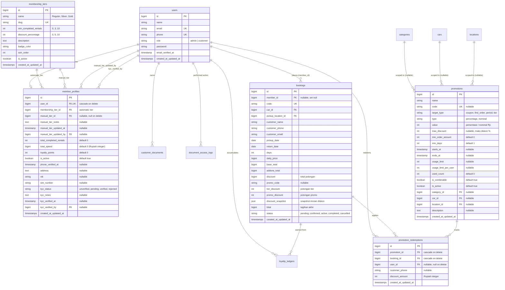

# Pembaruan Skema Basis Data (Database Updates) - Fase 1, Fase 2, & Fase 3
**Padaidi Rental Mobil - Membership Pelanggan, Diskon, Promosi, & Payment Gateway**

Dokumen ini mendokumentasikan secara rinci perubahan struktur basis data, relasi antarentitas, indeks performa, dan aturan integritas data yang ditambahkan pada **Fase 1 (Membership Pelanggan)**, **Fase 2 (Diskon & Promo)**, dan **Fase 3 (Payment Gateway & Refund)**.

---

## 1. Diagram Hubungan Entitas (Entity-Relationship Diagram / ERD)

---

## 2. Rincian Tabel Baru & Kolom (Fase 1 & 2)

### 2.1. Tabel `promotions` (Fase 2)
Menyimpan konfigurasi voucher, promo kupon, diskon musiman, dan diskon pengguna baru.
* `id` (`BIGINT UNSIGNED AUTO_INCREMENT PRIMARY KEY`)
* `name` (`VARCHAR(150)`): Nama promo / voucher.
* `code` (`VARCHAR(50) UNIQUE NULL`): Kode voucher promo (huruf kapital unik, `NULL` jika diskon otomatis tanpa kupon).
* `target_type` (`VARCHAR(30)`): `coupon`, `first_order`, `period`, `tier`.
* `type` (`VARCHAR(20)`): `percentage` (%) atau `nominal` (Rp).
* `value` (`INT UNSIGNED`): Nilai diskon (misal: 10 untuk 10%, atau 50000 untuk Rp 50.000).
* `max_discount` (`INT UNSIGNED NULL`): Batas maksimal potongan (khusus untuk tipe persentase).
* `min_order_amount` (`INT UNSIGNED DEFAULT 0`): Syarat minimal subtotal sewa mobil (Rupiah integer).
* `min_days` (`INT UNSIGNED DEFAULT 1`): Syarat minimal hari sewa mobil.
* `starts_at`, `ends_at` (`TIMESTAMP NULL`): Periode aktif promo.
* `usage_limit` (`INT UNSIGNED NULL`): Kuota pemakaian global.
* `usage_limit_per_user` (`INT UNSIGNED NULL`): Batas pemakaian per pengguna / nomor HP.
* `used_count` (`INT UNSIGNED DEFAULT 0`): Penghitung pemakaian real-time.
* `is_combinable` (`BOOLEAN DEFAULT TRUE`): Apakah boleh digabungkan dengan diskon tier member.
* `is_active` (`BOOLEAN DEFAULT TRUE`): Status sakelar aktif/nonaktif promo.
* `category_id`, `car_id`, `location_id` (`BIGINT UNSIGNED NULL`): Cakupan promo (scope).
* `description` (`TEXT NULL`): Deskripsi dan syarat ketentuan promo.
* `created_at`, `updated_at` (`TIMESTAMP`).

### 2.2. Tabel `promotion_redemptions` (Fase 2)
Mencatat riwayat penggunaan promo untuk audit, pembatasan kuota per pelanggan, dan pelaporan admin.
* `id` (`BIGINT UNSIGNED AUTO_INCREMENT PRIMARY KEY`)
* `promotion_id` (`BIGINT UNSIGNED NOT NULL`): Foreign key ke `promotions.id` (`ON DELETE CASCADE`).
* `booking_id` (`BIGINT UNSIGNED NOT NULL`): Foreign key ke `bookings.id` (`ON DELETE CASCADE`).
* `user_id` (`BIGINT UNSIGNED NULL`): Foreign key ke `users.id` (`ON DELETE SET NULL`).
* `customer_phone` (`VARCHAR(30) NULL`): Nomor HP pemesan untuk melacak kuota pemesanan tamu (*guest*).
* `discount_amount` (`INT UNSIGNED NOT NULL`): Nilai nominal Rupiah yang dipotong pada transaksi ini.
* `created_at`, `updated_at` (`TIMESTAMP`).

### 2.3. Pembaruan Kolom Tabel `bookings` (Fase 2)
* `promo_code` (`VARCHAR(50) NULL`): Kode voucher yang digunakan pada pesanan.
* `tier_discount` (`INT UNSIGNED DEFAULT 0`): Nominal potongan yang bersumber dari tingkatan member.
* `promo_discount` (`INT UNSIGNED DEFAULT 0`): Nominal potongan yang bersumber dari kode voucher promo.
* `discount_snapshot` (`JSON NULL`): Snapshot rincian perhitungan diskon (nama tier, nilai %, kode promo, nominal potongan tiap komponen) untuk integritas pelaporan historis.

### 2.4. Pembaruan Kolom Tabel `payments` (Fase 3)
Memperluas tabel `payments` dari transfer manual sederhana menjadi entitas pembayaran serbaguna:
* `reference_id` (`VARCHAR(100) UNIQUE NULL`): Nomor referensi transaksi internal Padaidi (misal: `PDD-PAY-PDD-XXXXXX-TIMESTAMP-RAND`).
* `external_id` (`VARCHAR(100) NULL INDEX`): ID transaksi atau tagihan dari penyedia Payment Gateway (misal: ID invoice Xendit).
* `payment_type` (`VARCHAR(30) DEFAULT 'full'`): Jenis pembayaran (`full`, `dp`, `settlement`).
* `channel` (`VARCHAR(50) DEFAULT 'manual_transfer'`): Kanal pembayaran (`qris`, `va_bca`, `va_mandiri`, `va_bni`, `va_bri`, `va_permata`, `manual_transfer`, `cash`).
* `gateway_name` (`VARCHAR(50) DEFAULT 'manual'`): Nama gateway yang memproses transaksi (`xendit`, `fake`, `manual`).
* `checkout_url` (`VARCHAR(255) NULL`): Tautan web checkout resmi jika dialihkan ke halaman gateway.
* `qr_code_url` (`VARCHAR(255) NULL`): Tautan gambar QR code QRIS untuk ditampilkan langsung ke pelanggan.
* `va_number` (`VARCHAR(50) NULL`): Nomor Virtual Account bank yang dapat disalin pelanggan.
* `expires_at` (`TIMESTAMP NULL INDEX`): Waktu batas kedaluwarsa pembayaran (otomatis ditutup oleh scheduler).
* `raw_response` (`JSON NULL`): Penyimpanan rekaman respon JSON mentah dari gateway untuk audit forensik.
* `failure_reason` (`TEXT NULL`): Catatan alasan bila pembayaran gagal, kedaluwarsa, atau ditolak.

### 2.5. Tabel `webhook_events` (Fase 3)
Menjamin keamanan idempotensi dan mencegah serangan *replay attack* pada notifikasi webhook gateway.
* `id` (`BIGINT UNSIGNED AUTO_INCREMENT PRIMARY KEY`)
* `gateway` (`VARCHAR(50)`): Nama gateway (`xendit`, `fake`).
* `event_id` (`VARCHAR(100) UNIQUE`): ID unik peristiwa dari gateway untuk penguncian idempoten.
* `event_type` (`VARCHAR(100)`): Tipe event (misal: `invoice.paid`, `payment.succeeded`).
* `payload` (`JSON`): Isi payload webhook lengkap dalam format JSON.
* `status` (`VARCHAR(30) DEFAULT 'pending'`): `pending`, `processed`, `ignored`, `failed`.
* `error_message` (`TEXT NULL`): Catatan kesalahan pemrosesan jika terjadi kendala teknis.
* `created_at`, `updated_at` (`TIMESTAMP`).

### 2.6. Tabel `payment_refunds` (Fase 3)
Mencatat seluruh riwayat pengembalian dana (*refund*) sewa secara transparan.
* `id` (`BIGINT UNSIGNED AUTO_INCREMENT PRIMARY KEY`)
* `payment_id` (`BIGINT UNSIGNED NOT NULL`): Foreign key ke `payments.id` (`ON DELETE CASCADE`).
* `booking_id` (`BIGINT UNSIGNED NOT NULL`): Foreign key ke `bookings.id` (`ON DELETE CASCADE`).
* `refunded_by` (`BIGINT UNSIGNED NULL`): Foreign key ke `users.id` (Admin penanggung jawab, `ON DELETE SET NULL`).
* `amount` (`BIGINT UNSIGNED NOT NULL`): Nominal uang yang dikembalikan ke pelanggan (Rupiah integer).
* `reason` (`VARCHAR(255) NOT NULL`): Alasan pembatalan atau refund.
* `status` (`VARCHAR(30) DEFAULT 'completed'`): `pending`, `completed`, `failed`.
* `notes` (`TEXT NULL`): Catatan tambahan atau ID refund dari payment gateway.
* `created_at`, `updated_at` (`TIMESTAMP`).

---

## 3. Aturan Integritas Data & Keuangan

1. **Integritas Moneter Tanpa Desimal (*Integer Rupiah*):** Seluruh kolom harga, tagihan, dan diskon disimpan dalam format integer Rupiah bulat tanpa desimal *floating point*.
2. **Kepatuhan Privasi Data Pribadi (UU PDP):** Berkas KTP dan SIM tersimpan di storage privat dan setiap pembukaan berkas tercatat permanen di `document_access_logs`.
3. **Idempotensi & Rollback Kuota Promo:** Jika pesanan dibatalkan (`Cancelled`), data penebusan di `promotion_redemptions` dihapus dan kuota promo dikembalikan (`used_count` didekremen) secara transaksional (`DB::transaction`).
4. **Idempotensi Webhook Finansial:** Kolom `event_id` pada tabel `webhook_events` memiliki indeks unik (*UNIQUE constraint*). Panggilan berulang dari gateway dengan event ID yang sama direspons 200 OK secara instan tanpa mengeksekusi mutasi saldo berulang kali.
5. **Pencegahan Over-Refund:** Total akumulasi pengembalian dana pada tabel `payment_refunds` tidak boleh melebihi nilai awal pembayaran (`amount`) yang tercatat pada tabel `payments`.
