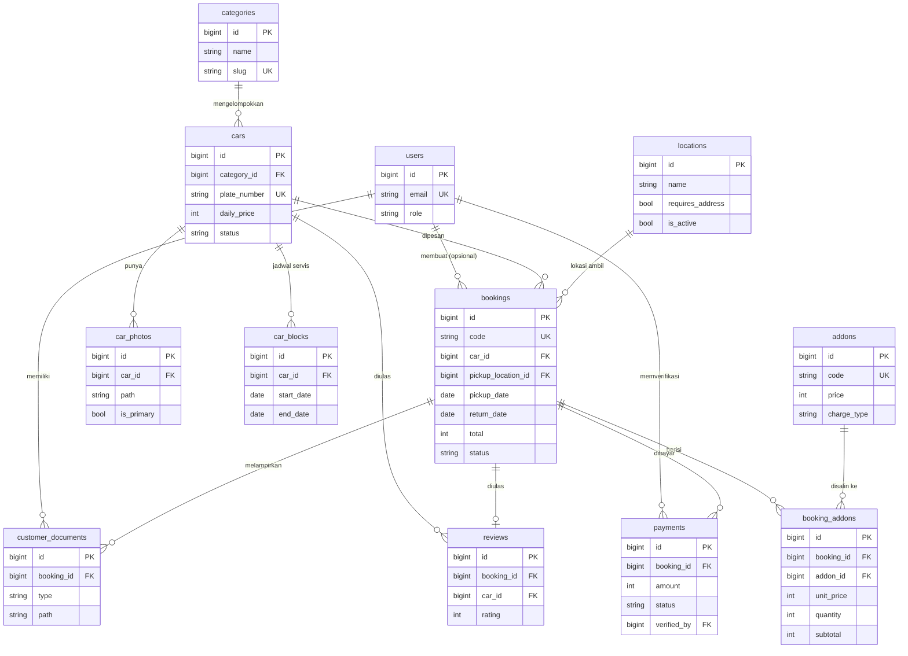

# Struktur Database Padaidi

Database utama: **MySQL 8 / MariaDB 10.6+** (juga berjalan di SQLite untuk uji coba & test otomatis).
Semua uang disimpan sebagai **bilangan bulat Rupiah** (tanpa desimal). Tanggal sewa disimpan sebagai `DATE` (tanpa jam).

## Urutan migrasi (mengikuti foreign key)

1. `users` (+ `password_reset_tokens`, `sessions`), `cache`, `jobs` – bawaan Laravel
2. `locations` 3. `categories` 4. `addons`
5. `cars` → categories
6. `car_photos` → cars
7. `car_blocks` → cars
8. `bookings` → users, cars, locations
9. `booking_addons` → bookings, addons
10. `payments` → bookings, users
11. `reviews` → bookings, cars
12. `customer_documents` → bookings, users (tahap lanjut, belum dipakai di layar)

## Daftar tabel & kolom penting

| Tabel | Kolom penting | Keterangan |
|---|---|---|
| `users` | name, email (unik), phone, password, **role** (`customer`/`admin`) | Admin login ke dasbor. Pelanggan saat ini memesan tanpa akun (`bookings.user_id` boleh kosong). |
| `locations` | name, slug, description, **requires_address**, is_active | "Antar ke alamat" memakai `requires_address = true`. |
| `categories` | name, slug, sort_order | City Car, MPV, SUV, Premium. |
| `addons` | **code** (unik), name, price, **charge_type** (`per_day`/`once`), is_active | `code = delivery` dipakai otomatis untuk lokasi antar. |
| `cars` | category_id, name, slug, brand, year, plate_number (unik), transmission, seats, fuel, **daily_price**, **status** (`available`/`maintenance`/`inactive`) | |
| `car_photos` | car_id, path, is_primary, sort_order | File di `storage/app/public/cars`. |
| `car_blocks` | car_id, **start_date**, **end_date** (inklusif), reason, notes | Jadwal servis / mobil tidak tersedia. |
| `bookings` | **code** (unik), user_id, car_id, pickup_location_id, delivery_address, data pelanggan (customer_name/phone/email/address), **pickup_date**, **return_date**, days, **daily_price, base_total, addons_total, discount, total** (salinan harga), **status**, notes, admin_notes, cancel_reason, confirmed_at, picked_up_at, completed_at, cancelled_at | Indeks `(car_id, status, pickup_date, return_date)` untuk cek ketersediaan cepat. |
| `booking_addons` | booking_id, addon_id (boleh null jika tambahan dihapus), **name, charge_type, unit_price, quantity, subtotal** | Salinan tambahan saat dipesan. |
| `payments` | booking_id, amount, method (`transfer`/`tunai`), sender_name, proof_path, **status** (`pending`/`verified`/`rejected`), paid_at, verified_by, verified_at, notes | Bukti di `storage/app/public/payments`. |
| `reviews` | booking_id (unik), car_id, customer_name, rating 1–5, comment, is_published | Satu ulasan per pesanan selesai. |
| `customer_documents` | booking_id, user_id, type (`ktp`/`sim`), path | Disiapkan untuk tahap lanjut; verifikasi dokumen di luar cakupan versi ini. |

## ERD



## Aturan irisan tanggal

- Pesanan memakai rentang setengah terbuka **[pickup_date, return_date)**. Dua pesanan beririsan jika
  `pesanan_lama.pickup_date < tanggal_kembali_baru` **dan** `pesanan_lama.return_date > tanggal_ambil_baru`.
- Jadwal servis inklusif **[start_date, end_date]**. Beririsan jika
  `start_date < tanggal_kembali_baru` **dan** `end_date >= tanggal_ambil_baru`.
- Hanya pesanan berstatus `pending`, `confirmed`, `active` yang menghalangi.

Semua query memakai Eloquent / parameter binding (tidak ada penyambungan string dari input pengguna).

## Pencegahan pesanan ganda

MySQL/MariaDB **tidak punya** constraint seperti `EXCLUDE USING gist` milik PostgreSQL yang bisa melarang dua rentang
tanggal beririsan di level database. Karena itu **pemeriksaan di level aplikasi adalah satu-satunya pengaman**, dan
pemeriksaan itu dilindungi transaksi + penguncian baris (`app/Services/BookingService.php`):

```php
DB::transaction(function () use ($car, $data) {
    // 1. Kunci baris mobil: SELECT * FROM cars WHERE id = ? FOR UPDATE
    $lockedCar = Car::whereKey($car->id)->lockForUpdate()->firstOrFail();

    // 2. Periksa ulang ketersediaan DI DALAM transaksi
    if (! $this->availability->isAvailable($lockedCar, $pickup, $return)) {
        throw new CarUnavailableException;
    }

    // 3. Hitung harga di server lalu simpan pesanan + salinan tambahan
});
```

Cara kerjanya: jika dua pelanggan menekan "Kirim pesanan" untuk mobil yang sama hampir bersamaan, permintaan kedua
harus **menunggu** sampai transaksi pertama selesai (karena baris mobil terkunci). Setelah itu permintaan kedua
memeriksa ulang, melihat pesanan pertama yang sudah tersimpan, dan ditolak dengan pesan
"mobil ini sudah tidak tersedia pada tanggal yang dipilih". Pemeriksaan di halaman pencarian/ringkasan hanya untuk
kenyamanan; keputusan akhir selalu di dalam transaksi ini.

Catatan:
- Tabel harus memakai engine **InnoDB** (bawaan MySQL/MariaDB modern) agar `FOR UPDATE` berfungsi.
- Perubahan status (`BookingService::transition`) juga memakai transaksi + `lockForUpdate` pada baris pesanan,
  sehingga dua admin yang menekan tombol bersamaan tidak membuat status melompat.
- SQLite (dipakai test) mengunci seluruh database saat menulis, jadi `lockForUpdate` diabaikan tetapi hasilnya tetap aman.
- Jika kelak pindah ke PostgreSQL, tambahkan lapisan kedua: kolom `daterange` + constraint
  `EXCLUDE USING gist (car_id WITH =, daterange(pickup_date, return_date, '[)') WITH &&) WHERE (status IN ('pending','confirmed','active'))`.
