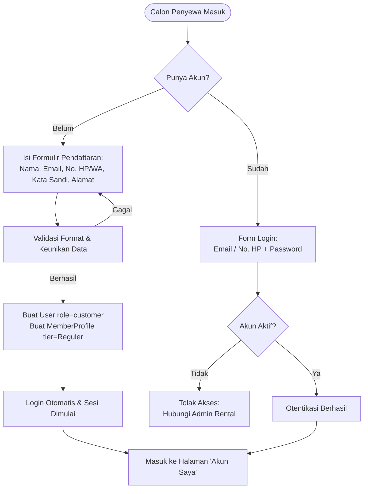
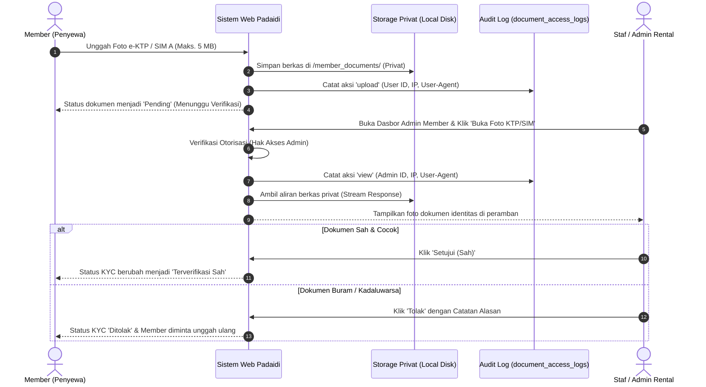
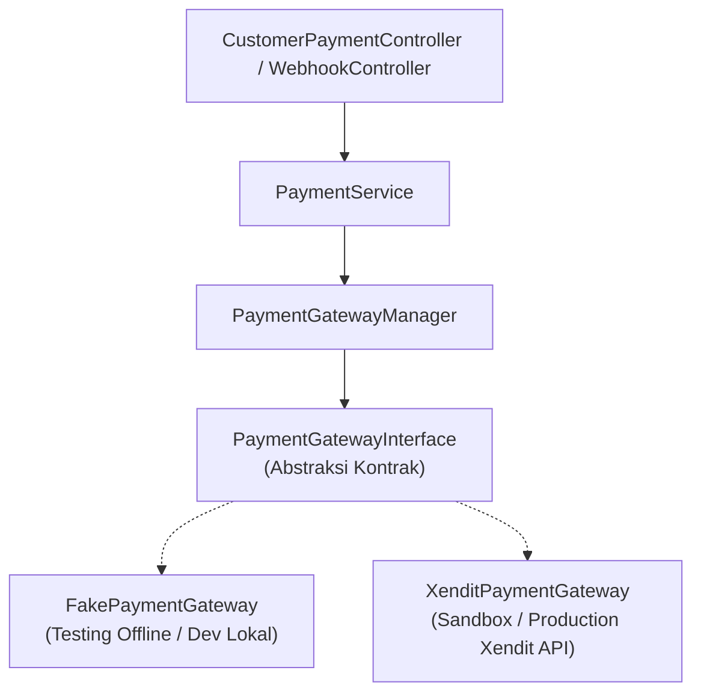
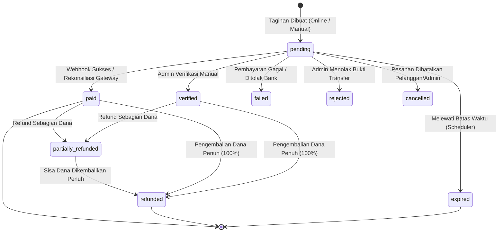
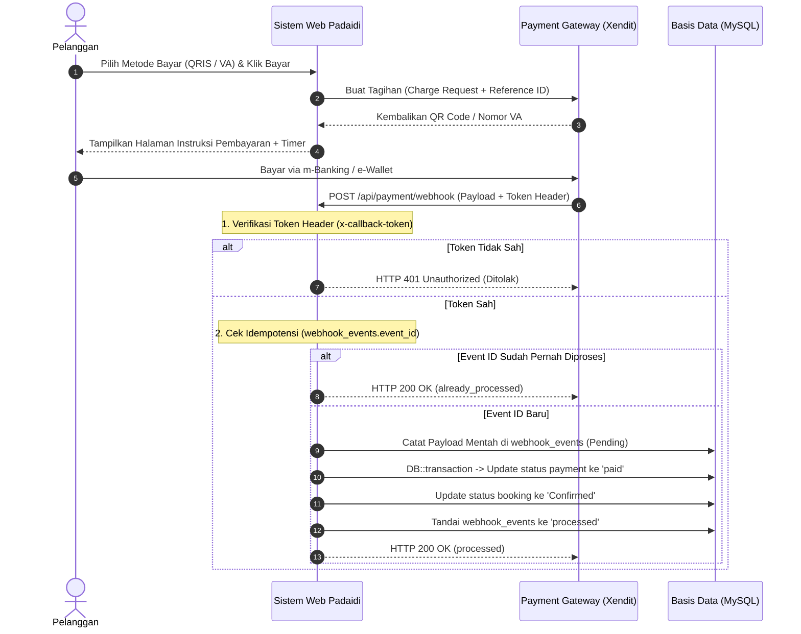

# Arsitektur & Dokumentasi Bisnis: Membership, Diskon, dan Payment Gateway
**Sistem Sewa Mobil Padaidi (Padaidi Rental Mobil)**

Dokumen ini menjelaskan rancangan komprehensif, arsitektur sistem, aturan bisnis, dan diagram alur fitur keanggotaan pelanggan (*Customer Membership*), pengelolaan diskon/promo, serta gerbang pembayaran (*Payment Gateway*). 

> **Status Pengembangan:** 
> * **Fase 1 - Membership Pelanggan:** Selesai Diimplementasikan (100% Lulus Uji)
> * **Fase 2 - Pengelolaan Diskon & Promo:** Selesai Diimplementasikan (100% Lulus Uji)
> * **Fase 3 - Payment Gateway Terperinci:** Selesai Diimplementasikan (100% Lulus Uji)

---

## 1. Fase 1: Keanggotaan Pelanggan (Customer Membership)

Fase 1 membangun fondasi akun pelanggan untuk mendorong loyalitas, retensi pelanggan, dan mitigasi risiko operasional melalui verifikasi identitas (e-KYC) yang aman dan mematuhi prinsip Perlindungan Data Pribadi (UU PDP).

### 1.1. Profil & Tingkat Keanggotaan (Membership Tiers)

Tingkat keanggotaan ditentukan secara otomatis oleh sistem berdasarkan **jumlah transaksi sewa mobil yang telah selesai (`Completed`)**:

| Tier | Syarat Minimum Sewa Selesai | Diskon Biaya Sewa Mobil | Warna Lencana | Keterangan |
| :--- | :---: | :---: | :---: | :--- |
| **Reguler** | 0 sewa | 0% | Slate / Standar | Diperoleh otomatis saat pertama kali mendaftar akun. |
| **Silver** | 3 sewa selesai | 5% | Perak (Silver) | Diskon 5% untuk tarif harian mobil pada sewa berikutnya. |
| **Gold** | 10 sewa selesai | 10% | Emas (Amber) | Diskon 10% untuk pelanggan prioritas / korporat. |

#### Aturan Poin Loyalitas:
* **Perolehan Poin:** Pelanggan mendapatkan **1 poin loyalitas** untuk setiap kelipatan **Rp 100.000** dari total transaksi sewa yang berstatus `Completed`.
* **Buku Besar Poin (*Ledger*):** Setiap perubahan poin dicatat di tabel `loyalty_ledgers` dengan pencatatan saldo sebelum dan sesudah perubahan (*audit trail*).

---

### 1.2. Alur Pendaftaran & Otentikasi Member

Pelanggan dapat mendaftar dengan cepat, melakukan verifikasi kontak (Email / WhatsApp), serta masuk (*login*) menggunakan alamat email atau nomor telepon yang terdaftar.



---

### 1.3. Alur Verifikasi Identitas (e-KYC) & Penyimpanan Dokumen Privat

Untuk memitigasi risiko penggelapan kendaraan pada paket lepas kunci (*self-drive*), pelanggan diwajibkan mengunggah foto/scan e-KTP dan SIM A.

#### Prinsip Keamanan & Privasi Data (UU PDP):
1. **Penyimpanan Privat (`Storage::disk('local')`):** Dokumen KTP dan SIM **tidak disimpan di direktori publik** (`storage/app/public`), melainkan di direktori privat yang tidak dapat diakses langsung via URL browser.
2. **Akses Terotorisasi:** Berkas hanya dapat dibuka melalui rute terenkripsi controller yang memverifikasi kepemilikan dokumen (`$user->id === $doc->user_id` atau `$user->isAdmin()`).
3. **Log Audit Akses (`document_access_logs`):** Setiap tindakan unggah (*upload*), pratinjau (*view*), atau unduh dokumen dicatat lengkap dengan ID pengguna, tipe dokumen, alamat IP, dan *User-Agent* peramban.



---

### 1.4. Aturan Pemesanan: Tamu (*Guest*) vs Member

Sistem Padaidi Rental Mobil tetap mengizinkan pelanggan yang belum memiliki akun untuk memesan mobil secara instan (*Guest Checkout*), namun memberikan keuntungan eksklusif bagi pelanggan yang telah menjadi Member:

1. **Pemesanan oleh Tamu (*Guest*):**
   * Nilai kolom `bookings.member_id` bernilai `NULL`.
   * Tamu dapat memantau status pesanan kapan saja melalui menu **Cek Pesanan** menggunakan kode pemesanan unik dan nomor WhatsApp.
2. **Pemesanan oleh Member:**
   * Kolom `bookings.member_id` terisi otomatis dengan ID akun member.
   * Riwayat sewa terhubung langsung ke halaman **Akun Saya &rarr; Riwayat Pesanan**.
   * Formulir pemesanan otomatis terisi (*auto-fill*) nama, nomor telepon, dan email member.
   * Transaksi sewa yang diselesaikan (`BookingStatus::Completed`) langsung menambahkan akumulasi sewa, poin loyalitas, dan memicu kenaikan tier secara otomatis.

---

### 1.5. Kontrol Manajemen Admin (*Admin Member Management*)

Admin rental mobil memiliki kendali penuh melalui antarmuka admin di `/admin/member`:
* **Pencarian & Filter:** Menemukan member berdasarkan nama, email, nomor HP, tingkatan tier, dan status e-KYC.
* **Override Tier Manual:** Admin dapat menaikkan atau menurunkan tier member secara manual (misalnya untuk tamu kehormatan/instansi rekanan) dengan **catatan alasan wajib** (*mandatory notes*) dan pencatatan staf yang mengubahnya.
* **Reset Tier Manual:** Kemampuan mengembalikan status member ke perhitungan otomatis berbasis riwayat transaksi.
* **Nonaktifkan Akun:** Membekukan akses login member yang bermasalah atau melakukan pelanggaran operasional.
* **Audit Trail Dokumen:** Memeriksa log pembukaan berkas KTP dan SIM di `/admin/member/logs` untuk transparansi internal.

---

## 2. Fase 2: Pengelolaan Diskon & Promo (Discount & Promotion Engine)

Fase 2 menyediakan mesin perhitungan diskon server-side yang aman dan tegas, mencegah manipulasi harga dari sisi browser (*client-side*), serta mendukung pengelolaan promosi lengkap di panel admin.

### 2.1. Arsitektur Mesin Perhitungan Harga & Diskon (Order of Application)

Sesuai aturan bisnis rental kendaraan, diskon dihitung secara transparan dan berjenjang dengan urutan matematis yang ketat:

```mermaid
flowchart TD
    Subtotal[1. Subtotal Sewa Mobil\nTarif Harian x Jumlah Hari] --> StepTier{Member Punya Tier?}
    StepTier -- Ya --> PotongTier[2. Terapkan Diskon Tier (%)\nContoh: Silver 5%, Gold 10%\nMemotong Subtotal Mobil]
    StepTier -- Tidak --> Sisa1[Sisa Subtotal Mobil]
    PotongTier --> Sisa1
    Sisa1 --> StepPromo{Input Kode Promo Valid?}
    StepPromo -- Ya --> PotongPromo[3. Terapkan Diskon Promo\nPersentase dahulu, lalu Nominal Tetap\nTidak Melebihi Sisa Subtotal Mobil]
    StepPromo -- Tidak --> SubtotalBersih[Subtotal Mobil Setelah Diskon]
    PotongPromo --> SubtotalBersih
    SubtotalBersih --> TambahAddons[4. Tambahkan Biaya Layanan Tambahan (Addons)\nAsuransi, Sopir, Antar-Jemput]
    TambahAddons --> TotalTagihan[5. Total Tagihan Akhir (Grand Total)\nTidak Boleh Bernilai Negatif]
    TotalTagihan --> HitungDP[6. Hitung Skema Pembayaran:\n- Uang Muka / DP 30%\n- Sisa Pelunasan 70%]
```

#### Aturan Penting Mesin Diskon:
1. **Objek Pemotongan Diskon:** Diskon **hanya memotong subtotal sewa mobil**, tidak pernah memotong biaya layanan tambahan (*addons*) seperti Asuransi, Fee Sopir, atau Biaya Antar-Jemput.
2. **Batas Maksimal Potongan:** Total diskon (gabungan tier dan promo) tidak boleh melebihi 100% dari subtotal sewa mobil (biaya sewa mobil maksimal menjadi Rp 0, tidak boleh minus).
3. **Penyimpanan Snapshot Diskon:** Rincian perhitungan diskon (`tier_discount`, `promo_discount`, nama tier, kode promo, dan nominal potongan) disimpan dalam kolom JSON `bookings.discount_snapshot` untuk menjaga integritas data historis meskipun promo di masa depan diubah atau dihapus.

---

### 2.2. Contoh Baku Perhitungan Keuangan

Sesuai spesifikasi baku:
* **Mobil:** Toyota Agya (Rp 300.000/hari)
* **Durasi:** 3 hari
* **Layanan Tambahan:** Asuransi (Rp 50.000/hari x 3 = Rp 150.000)
* **Member:** Silver (Diskon 5% dari sewa mobil)
* **Kode Promo:** `PADAIDI50K` (Potongan nominal Rp 50.000)

$$\text{Subtotal Sewa Mobil} = 300.000 \times 3 = 900.000$$
$$\text{Diskon Member Silver (5\%)} = 5\% \times 900.000 = 45.000$$
$$\text{Diskon Kode Promo Nominal} = 50.000$$
$$\text{Total Diskon} = 45.000 + 50.000 = 95.000$$
$$\text{Total Tagihan Akhir} = 900.000 + 150.000 - 95.000 = 955.000$$
$$\text{Uang Muka (DP 30\%)} = 30\% \times 955.000 = 286.500$$
$$\text{Sisa Pelunasan (70\%)} = 955.000 - 286.500 = 668.500$$

---

### 2.3. Fitur CRUD Diskon & Promo di Admin

Admin dapat mengelola promo melalui rute `/admin/promosi`:
* **Tipe Target Promo:**
  * `coupon`: Kupon kode voucher (misal: `PADAIDI50K`, `HEMAT10`).
  * `first_order`: Khusus pelanggan yang belum pernah memiliki riwayat pemesanan.
  * `period`: Promo musiman / periode liburan (Hari Raya, Nataru).
  * `tier`: Diskon khusus tingkatan member.
* **Aturan & Batasan Promo:**
  * Tipe potongan: Persentase (%) atau Nominal Tetap (Rp).
  * Batas maksimal potongan (`max_discount`) untuk tipe persentase.
  * Minimal subtotal transaksi dan minimal hari sewa.
  * Kuota pemakaian global (`usage_limit`) dan kuota maksimal per pengguna (`usage_limit_per_user`).
  * Masa aktif tanggal mulai (`starts_at`) dan tanggal berakhir (`ends_at`).
  * Cakupan kendaraan: Berlaku untuk semua mobil, kategori tertentu (misal: khusus SUV), atau mobil spesifik.
  * Cakupan lokasi penjemputan.
  * Aturan penggabungan (`is_combinable`): Apakah dapat digabung dengan diskon tier member.

---

### 2.4. Pencatatan Pemakaian Promo (*Redemptions*) & Rollback Otomatis

* **Pencatatan Penebusan:** Saat pesanan dibuat dengan kode promo valid, data pemakaian dicatat ke tabel `promotion_redemptions` dan kolom `promotions.used_count` bertambah 1.
* **Rollback Pembatalan Pesanan:** Jika pesanan dibatalkan (`BookingStatus::Cancelled`), sistem secara otomatis menghapus pencatatan redemption dan mengembalikan kuota pemakaian promo (`$promo->decrement('used_count')`) sehingga kuota pelanggan tidak hangus.
* **Laporan Pemakaian Promo (`/admin/promosi/laporan`):** Menampilkan metrik ringkasan (Total Penebusan, Total Nilai Diskon, Rata-rata Penghematan) serta tabel histori pemakaian per pesanan dengan filter tanggal.

---

## 3. Fase 3: Gerbang Pembayaran Terperinci (*Payment Gateway*)

Fase 3 mengintegrasikan gerbang pembayaran digital berstandar industri dengan arsitektur abstraksi (*driver pattern*), state machine keuangan yang ketat, perlindungan webhook idempoten, rekonsiliasi terjadwal, dan cetak invoice resmi.

### 3.1. Arsitektur Abstraksi Gateway (*Driver Pattern*)

Sistem tidak mengikat logika bisnis ke salah satu penyedia gateway secara langsung. Seluruh interaksi gerbang pembayaran diakses melalui interface standar `App\Services\Payment\PaymentGatewayInterface` yang dikelola oleh `PaymentGatewayManager`:



#### Driver yang Tersedia:
1. **`FakePaymentGateway` (`PAYMENT_GATEWAY_DRIVER=fake`):**
   * Driver tiruan deterministik untuk keperluan pengujian otomatis (PHPUnit) dan demonstrasi offline.
   * Menghasilkan QR code instan dan nomor Virtual Account berawalan kode bank (BCA: 8801, BNI: 8802, BRI: 8803, Mandiri: 8804, Permata: 8805).
   * Memungkinkan pengujian 100% tanpa jaringan internet atau biaya transaksi.
2. **`XenditPaymentGateway` (`PAYMENT_GATEWAY_DRIVER=xendit`):**
   * Terintegrasi langsung dengan API resmi Xendit (v2 invoice / payment requests).
   * Mendukung QRIS dinamis instan dan Virtual Account bank besar di Indonesia.
   * Memvalidasi *Webhook Token / Signature* resmi dari Xendit.

---

### 3.2. Metode Pembayaran & Opsi Uang Muka (DP 30%)

Sistem menyediakan fleksibilitas pembayaran bagi pelanggan:
* **Uang Muka (DP 30%):** Dihitung otomatis di server sebesar 30% dari total tagihan pesanan (`min($remaining, round($grandTotal * 0.3))`). Memungkinkan pelanggan mengunci jadwal mobil dengan biaya awal terjangkau.
* **Bayar Penuh (100%):** Membayar seluruh tagihan sekaligus hingga pesanan berstatus lunas.
* **Pelunasan Sisa (*Settlement*):** Membayar sisa tagihan yang belum terbayar sebelum atau saat mobil diambil.
* **Kanal Pembayaran Terverifikasi Otomatis:**
  * **QRIS:** Mendukung pemindaian dari BCA, Livin Mandiri, BRImo, BNI Mobile, GoPay, OVO, DANA, ShopeePay, LinkAja.
  * **Virtual Account Bank:** BCA, Mandiri, BNI, BRI, Permata Bank.
  * **Transfer Bank Manual:** Tetap tersedia sebagai alternatif cadangan dengan unggah bukti transfer.

---

### 3.3. State Machine Pembayaran & Siklus Transaksi



* **Otomasi Konfirmasi Pesanan:** Ketika tagihan pembayaran DP atau lunas berhasil (`paid` atau `verified`), pesanan yang berstatus `Pending` secara otomatis bertransisi ke `Confirmed`.

---

### 3.4. Alur Notifikasi Webhook yang Aman & Idempoten

Webhook gerbang pembayaran rentan terhadap pengiriman ulang (*network retry / replay attack*). Sistem Padaidi menerapkan pola pertahanan berlapis:



---

### 3.5. Penjadwal Otomatis (*Scheduler & Artisan Commands*)

Dua perintah artisan khusus terdaftar di sistem dan dijadwalkan secara berkala (`routes/console.php`):
1. **`php artisan payments:expire` (Dijalankan setiap jam):**
   * Memeriksa seluruh transaksi berstatus `pending` yang kolom `expires_at`-nya telah melewati waktu saat ini.
   * Mengubah status pembayaran menjadi `expired` dengan catatan kegagalan otomatis.
2. **`php artisan payments:reconcile` (Dijalankan setiap 15 menit):**
   * Melakukan panggilan API aktif ke payment gateway untuk memeriksa status mutakhir dari transaksi pending ber-ID gateway eksternal.
   * Menyelamatkan transaksi yang pembayarannya sukses di gateway namun notifikasi webhook-nya terhambat koneksi jaringan.

---

### 3.6. Mekanisme Pengembalian Dana (*Refund*) & Ekspor CSV

* **Perhitungan Refund Aman:**
  * Pengembalian dana hanya diperbolehkan untuk transaksi yang sukses (`paid`, `verified`, atau `partially_refunded`).
  * Sistem menghitung sisa dana yang dapat dikembalikan (`refundableAmount = amount - sum(completed_refunds)`). Nominal refund yang diajukan tidak dapat melebihi sisa dana tersebut.
  * Setiap tindakan refund dicatat di tabel `payment_refunds` lengkap dengan alasan, nominal, dan admin penanggung jawab.
* **Dasbor & Ekspor Laporan Pembayaran (`/admin/pembayaran`):**
  * Kartu metrik: Total Diterima, Menunggu Pembayaran, dan Total Refund.
  * Filter multi-kriteria: Status, kanal pembayaran, rentang tanggal transaksi, serta pencarian instan (kode pesanan, referensi, nama penyewa).
  * Tombol **Ekspor Data (CSV)**: Menghasilkan berkas CSV terstruktur siap olah di Excel/Spreadsheet.

---

### 3.7. Faktur / Invoice Resmi (*Printable & PDF Ready*)

Setiap pesanan dilengkapi faktur resmi (`/pesanan/{code}/invoice`):
* Desain elegan dan responsif dengan dukungan cetak A4 bersih menggunakan CSS `@media print` (menyembunyikan tombol navigasi, tanpa margin berlebih).
* Informasi lengkap: Kop resmi Padaidi Rental Mobil, nomor invoice unik (`INV-{code}`), cap status pembayaran digital (Lunas / DP Sebagian / Belum Bayar), rincian data penyewa & status member, spesifikasi armada, perincian harga sewa + addon + diskon promo/tier, serta riwayat pembayaran dan syarat ketentuan sewa.

---

### 3.8. Panduan Beralih ke Produksi (*Sandbox to Production Guide*)

Untuk mengaktifkan pembayaran langsung menggunakan akun Xendit Production:

1. **Daftar & Aktivasi Akun Xendit:**
   * Buat akun di [dashboard.xendit.co](https://dashboard.xendit.co).
   * Lengkapi dokumen legalitas usaha (KYB) untuk mengaktifkan mode *Live / Production*.
2. **Dapatkan Kunci API:**
   * Di Dashboard Xendit, buka menu **Settings** &rarr; **API Keys**.
   * Buat *Secret Key* baru dengan izin penuh untuk *Invoices* dan *Payment Methods*.
3. **Konfigurasi Webhook Xendit:**
   * Buka menu **Settings** &rarr; **Callbacks**.
   * Masukkan URL Webhook: `https://domain-anda.com/api/payment/webhook`.
   * Salin kode **Webhook Verification Token** yang diberikan Xendit.
4. **Perbarui Berkas `.env` Aplikasi:**
   ```env
   PAYMENT_GATEWAY_DRIVER=xendit
   XENDIT_SECRET_KEY=xnd_production_xxxxxxxxxxxxxxxxxxxxxxxx
   XENDIT_WEBHOOK_TOKEN=token_callback_dari_dashboard_xendit
   XENDIT_ENV=production
   PAYMENT_EXPIRY_HOURS=24
   PAYMENT_DP_ENABLED=true
   PAYMENT_DP_PERCENTAGE=30
   ```
5. **Uji Transaksi Nyata:**
   * Buat pesanan uji coba dengan nominal kecil (misal: Rp 10.000).
   * Lakukan pembayaran via QRIS m-Banking.
   * Pastikan webhook diterima dan pesanan otomatis berubah status menjadi `Confirmed`.

